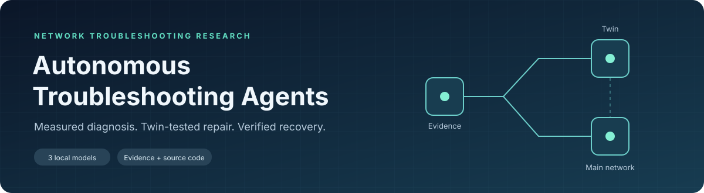
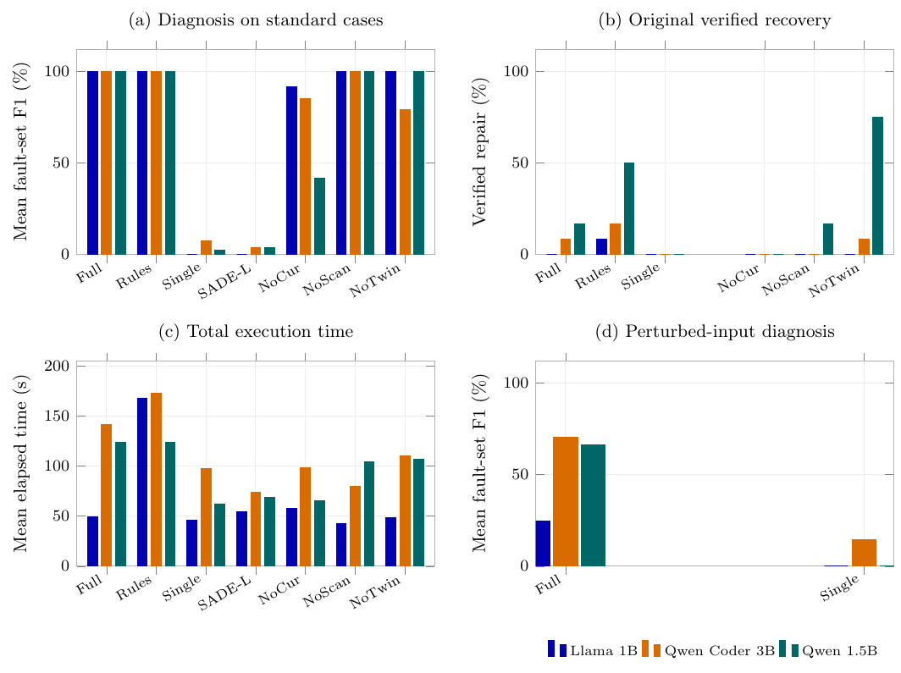
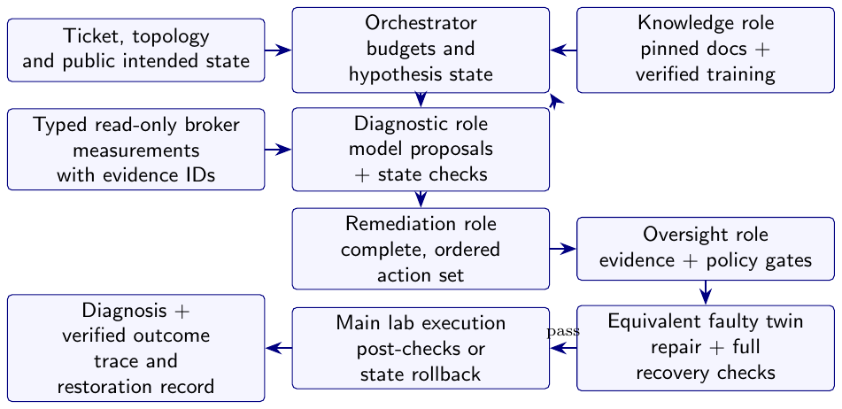

<div align="center">



# Autonomous Network Troubleshooting Agents

**A research implementation for multi-fault network diagnosis and verified repair using local language models.**

[Download submission ZIP](Phase4_24i-2545.zip) · [Read the paper](Phase4_Research_Paper_24i-2545.pdf) · [Explore the source](Implementation/src/neta) · [Setup and evidence](docs/REPRODUCIBILITY.md)


**Muhammad Umair Ahmad** · 24i-2545 · Section AI-C<br>
[i242545@isb.nu.edu.pk](mailto:i242545@isb.nu.edu.pk)

</div>

## Overview

A correct diagnosis does not always lead to a successful repair. An agent can identify the faults but omit a dependent route, propose an incomplete action set, or change the network before checking the outcome.

This project connects the diagnosis to the repair. It gathers measured evidence, confirms the complete fault set against public network intent, prepares ordered restorative actions, and tests them on a twin with the same faulty state. The main network is changed only after the required checks pass. Failed execution or post-checks trigger rollback.

Five logical roles share the selected local model: **Orchestrator, Diagnostic, Knowledge, Remediation, and Oversight**. The implementation runs on a four-device static IPv4 network and includes single faults, concurrent faults, a healthy case, and perturbed inputs.

## Results

The original study provides matched baseline, ablation, and robustness comparisons. The revised follow-up evaluates the combined improvements to repair planning and approval.

| Revised workflow | Exact diagnosis | Verified repair | Mean total time |
|:--|--:|--:|--:|
| Llama 3.2 1B | 7/7 | 6/6 | 111.7 s |
| Qwen 2.5 Coder 3B | 7/7 | 6/6 | 167.3 s |
| Qwen 2.5 1.5B | 7/7 | 6/6 | 113.2 s |
| **Total** | **21/21** | **18/18** | — |

- **Matched diagnosis:** the full workflow achieves 100% F1 and exact diagnosis across 42 original standard executions, matching the rule-based reference.
- **Verified incident knowledge:** removing curated incidents reduces exact diagnosis by 7.1–57.1 percentage points across the models.
- **Recovery controls:** all eight controlled safety executions show the expected blocking or rollback behaviour.
- **Recorded evidence:** 294 comparative runs, 72 robustness runs, and a separate 21-run revised follow-up are included with their protocols and raw records.

The revised follow-up is separate from the original matched study. Results cover the evaluated static IPv4 network; published SADE scores are distinguished from the local SADE adaptation. The paper reports the original repair outcomes, statistical analysis, and comparison conditions in full.

<details>
<summary><strong>View the original comparative results</strong></summary>



The figure uses the saved Phase 3 means. SADE-local is diagnosis-only, so its repair score is not applicable. [Summary data](Evaluation/Original%20study/summary.csv) · [Paired statistics](Evaluation/Original%20study/paired-comparisons.csv)

</details>

## How it works

1. **Measure the network.** Collect interface, address, route, firewall, and connectivity observations with evidence identifiers.
2. **Retrieve and diagnose.** Use pinned documentation and verified training incidents, then confirm supported faults against measured state and public intent.
3. **Plan the repair.** Require the complete distinct action set and restore links and addresses before dependent routes.
4. **Test the twin.** Check policy, fresh preconditions, faulty-state equivalence, and recovery before main-network execution.
5. **Verify or roll back.** Check connectivity and intended configuration after execution. Restore the captured pre-repair state if checks fail.



The agent container is unprivileged and read only. It has no access to the Docker socket or evaluator-only fault labels. Evaluation labels are included in the artifact for scoring; they are kept outside the agent's information boundary.

## Use the final code

```sh
git clone https://github.com/Muhammad-Umair-Ahmad/Autonomous-Troubleshooting-Agents.git
cd Autonomous-Troubleshooting-Agents
```

The agent implementation is in [`Implementation/src/neta/`](Implementation/src/neta). The `neta` launcher runs diagnosis, knowledge retrieval, experiments, recovery checks, and scoped cleanup. Final datasets, frozen configuration, knowledge snapshots, and tests are included.

### Run the agent

Live execution requires Python 3.12+, Docker, Kathará, Ollama, the named models, and the prepared pinned image/prerequisite records described in the Phase 3 operating guide. Python environments, downloaded runtimes, and model binaries are not versioned here.

```sh
cd Implementation
python3 -m venv .venv
.venv/bin/python -m pip install -r requirements-lock.txt
.venv/bin/python -m pip install -e . --no-deps
scripts/neta diagnose --case dev-route--standard --improved --knowledge curated-v1
```

Select another retained backbone with `--model qwen2.5-coder:3b` or `--model llama3.2:1b`. The command runs the final revised workflow on a development case. See the [reproduction guide](docs/REPRODUCIBILITY.md) for environment requirements, saved protocols, and result locations.

## Paper and experimental evidence

The final [research paper](Phase4_Research_Paper_24i-2545.pdf) includes the methodology, matched comparisons, ablations, safety tests, and discussion. Its [editable manuscript](Phase4_Research_Paper/source/paper.tex), bibliography, Springer template files, and figure sources are retained. Upload `Phase4_Research_Paper/source/` to Overleaf and choose `paper.tex` to edit or compile it.

The saved results can be inspected directly:

| Evidence | Location |
|:--|:--|
| Original comparison means | [summary.csv](Evaluation/Original%20study/summary.csv) |
| Paired statistical comparisons | [paired-comparisons.csv](Evaluation/Original%20study/paired-comparisons.csv) |
| Revised system results | [followup.csv](Evaluation/Revised%20study/followup.csv) |
| Original raw executions | [366 JSON records](Evaluation/Original%20raw%20runs/) |
| Revised raw executions | [21 JSON records](Evaluation/Revised%20raw%20runs/) |
| Controlled safety outcomes | [controlled-safety.json](Evaluation/Original%20study/controlled-safety.json) |

## Repository guide

| Location | Contents |
|:--|:--|
| [`Implementation/src/neta/`](Implementation/src/neta) | Final agent, CLI, diagnosis, retrieval, orchestration, and repair controls |
| [`Implementation/scripts/neta`](Implementation/scripts/neta) | Runtime launcher |
| [`Implementation/tests/`](Implementation/tests) | Contract, ablation, recovery, and opt-in live tests |
| [`Implementation/configs/`](Implementation/configs) | Saved protocols, environment versions, source and model identities |
| [`Implementation/data/`](Implementation/data) | Public cases and evaluator-only synthetic fault labels |
| [`Implementation/knowledge/`](Implementation/knowledge) | Documentation and frozen retrieval snapshots |
| [`Evaluation/`](Evaluation) | Raw outcomes, summaries, statistics, and safety evidence |
| [`Phase4_Research_Paper_24i-2545.pdf`](Phase4_Research_Paper_24i-2545.pdf) | Final research paper |
| [`Phase4_Research_Paper/source/`](Phase4_Research_Paper/source) | Editable paper, references, template files, and figures |
| [`docs/REPRODUCIBILITY.md`](docs/REPRODUCIBILITY.md) | Setup requirements and experimental evidence locations |
| [`Figures/`](Figures) | Original Phase 3 charts |
| [`Phase3_Implementation_and_Evaluation_24i-2545.pdf`](Phase3_Implementation_and_Evaluation_24i-2545.pdf) | Implementation report and operating guide |

The Phase 1 literature review and Phase 2 methodology report are preserved in the repository root.

## Research provenance

The work builds on [SADE](https://github.com/Overlxrd-uwu/SADE-NetworkAgent), [NIKA](https://github.com/sands-lab/nika), and [FaulT-Bench](https://github.com/Overlxrd-uwu/FaulT-Bench), with network emulation through [Kathará](https://github.com/KatharaFramework/Kathara). Upstream commits and retrieved-content hashes are recorded in [`sources.lock.json`](Implementation/configs/sources.lock.json). Full academic references and the AI-tool usage declaration are included in the paper. Upstream components retain their respective licenses.
